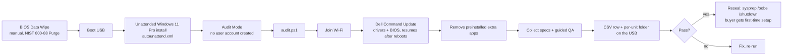

# refurb-usb

One USB stick that takes a wiped business laptop to a resealed, ready-to-sell unit with a per-device QA record.

Built for a small electronics refurbishing business processing batches of used Dell Latitude laptops. Each laptop used to take 30–45 minutes of clicking through Windows setup, driver installs and manual checks. With this kit the hands-on part is a few minutes per unit, and several laptops install side by side.

> [!WARNING]
> **This USB erases the internal drive of any computer that boots from it.** The answer file wipes disk 0 with no prompt. Label the stick and never leave it plugged into a computer you care about when it restarts.

## What it does



**Collected automatically for each unit:** service tag, model, BIOS version, CPU, RAM per slot, drive model and serial, drive health / wear / power-on hours, battery design vs full-charge capacity and cycle count (plus the full `powercfg` battery report), Windows edition and activation, the edition of the license stored in the BIOS, Wi-Fi / Bluetooth / camera presence, and any devices in an error state.

**Guided hands-on QA:** full-screen color test for dead pixels, a keyboard tester that lists every key Windows registers, a generated left/right speaker tone, then y/n questions for trackpad, ports, HDMI, headphone jack, mic, webcam, charging and hinges, plus a cosmetic grade.

**Reseal for the buyer:** removes the Wi-Fi profile and script files, turns off the temporary registry guards, deletes cached copies of the answer file (otherwise the buyer would boot into Audit Mode again), waits for the USB to be unplugged, then runs `sysprep /oobe /shutdown`.

## What stays manual

- **Firmware diagnostics and the BIOS Data Wipe.** Both live in the firmware and require someone at the keyboard by design.
- **The company-enrollment (Windows Autopilot) check.** Audit Mode skips the setup screen where a previous organization's sign-in would appear. Check each resealed unit once on a phone hotspot (see the per-laptop steps).

## Setup (one time)

1. Make a Windows 11 USB (16 GB+) with Microsoft's [Media Creation Tool](https://www.microsoft.com/software-download/windows11). If you use Rufus instead, untick all of its Windows customization options.
2. Copy `usb/autounattend.xml` and the `usb/refurb` folder to the root of the stick.
3. Download **Dell Command | Update Windows Universal Application** from Dell's support site and the **.NET Desktop Runtime** x64 installer it requires from Microsoft, and put both `.exe` files in `refurb/installers/`. Neither is included here because they aren't ours to redistribute.
4. Copy `refurb/config.example.ps1` to `refurb/config.ps1` and fill in your Wi-Fi name and password (WPA2), or leave them blank and use a USB Ethernet adapter. Edit the app removal list if you like.
5. Test on one laptop before using it on a batch.

```
USB root
├── autounattend.xml
├── refurb/
│   ├── audit.ps1
│   ├── config.ps1          (your copy of config.example.ps1)
│   ├── installers/
│   │   └── Dell-Command-Update-Application-....EXE
│   └── reports/            (created on first run)
└── (Microsoft's Windows setup files)
```

## Per laptop

1. **F2 (BIOS):** note whether a BIOS admin password is set. If storage is set to *RAID On*, switch it to *AHCI/NVMe* so Windows Setup can see the drive. Run *Data Wipe on Next Boot* and photograph the completion screen.
2. **F12 → Diagnostics:** run the full test.
3. **F12 → UEFI USB:** boot the stick with the charger connected and walk away.
4. When the audit window opens, type the unit ID from the laptop's label. Answer the QA prompts when they appear. A *System Preparation Tool* window may also open on its own; close it.
5. Results land on the stick: `refurb/reports/inventory.csv` (one row per laptop) and `refurb/reports/<UnitID>_<ServiceTag>/` (battery report, update logs, transcript, summary).
6. If the unit passes, answer `y` to reseal, unplug the USB when asked, and let it shut down.
7. **Company-lock check:** power on, join a phone hotspot, go to the sign-in screen. A personal Microsoft sign-in is clean; a company name means the unit is still enrolled with its previous owner.

## Requirements and limits

- Dell business laptops (built and tested on Latitude 3420). Other brands would need a different driver step.
- Windows 11 **Pro**: business Latitudes ship with a Pro license in the BIOS. The script flags any unit whose BIOS license is a different edition.
- Windows PowerShell 5.1 (built into Windows 11). No third-party modules.
- `dcu-cli` exit codes 1 and 5 are treated as "restart needed". If your Dell Command | Update version reports differently, check `dcu-cli /help`.
- WPA2 Wi-Fi only (WPA3-only networks won't join).

## What it deliberately doesn't do

It doesn't disable Windows Update, Defender, telemetry or services. Those "debloat" tweaks break updates and security features and make a resold machine look tampered with. Speed comes from a clean install, current drivers and BIOS, and the app removal list in `config.ps1`. Everything removed can be reinstalled from the Microsoft Store.

## Troubleshooting

| Symptom | Likely cause |
| --- | --- |
| "Windows cannot locate disk 0" | BIOS storage mode is *RAID On*, or the drive has failed |
| Laptop shuts down right after booting the USB | Safety stop: Windows Setup saw the USB stick as disk 0. Move the stick to another port and boot again |
| Unit ID has odd characters | Only letters, digits, `-` and `_` are kept for folder names |
| Script window didn't open | Open the USB in File Explorer, right-click `refurb\audit.ps1` → *Run with PowerShell* |
| "Not activated" | No internet yet; re-run the script once online |
| "BIOS license is … not Pro" | The unit shipped with a different edition; reinstall that edition |
| Sysprep failed | See `C:\Windows\System32\Sysprep\Panther\setuperr.log` |

## Results

_To be filled in after the first batch: units processed, average hands-on time per unit before and after, issues found by the automated checks._

## License

MIT. See [LICENSE](LICENSE).
